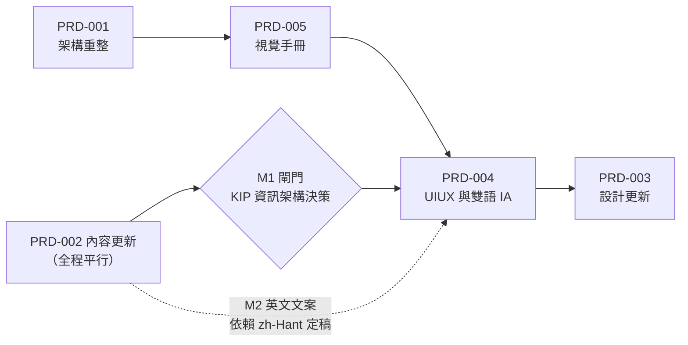

# synaiq-web 文件索引

本目錄是 SynaiQ 官網（repo `synaiq-web`，branch `main`）的規格入口，共 5 份 PRD、1 份精簡
guideline、1 份 PRD 模板與 ADR 流程。

**怎麼用**：先讀 [`HANDOVER.md`](../HANDOVER.md)（接手時的技術現況與已知缺陷，唯一技術事實
來源），再讀 [`guidelines/PRD-Guideline-Web.md`](guidelines/PRD-Guideline-Web.md)（本專案的 PRD
寫法、全站 NFR 基準線、不適用章節對照），最後依下表順序讀對應 PRD。每份 PRD 只寫該工作線的
差異，共通資訊一律連結、不複製。新增 PRD 複製 [`prd/_TEMPLATE.md`](prd/_TEMPLATE.md)；PRD
Locked 之後的範圍或架構變更一律開 [ADR](adr/README.md)。

## 狀態總表

| PRD | 標題 | 版本 | 狀態 | Owner | ADO Feature | 順序 |
|---|---|---|---|---|---|---|
| [PRD-001](prd/PRD-001-architecture-refactor.md) | 架構重整：Astro + React islands 換底重建 | v1.0 | Locked | Dale | [#1296](https://dev.azure.com/synaiq/SynaiqDev/_workitems/edit/1296) | 1 |
| [PRD-002](prd/PRD-002-kip-content.md) | SYNAIQ KIP 產品線資訊更新 | v0.1 | Draft | Dale | [#1297](https://dev.azure.com/synaiq/SynaiqDev/_workitems/edit/1297) | 平行（M1 為 004 的前置閘門） |
| [PRD-003](prd/PRD-003-visual-design.md) | 設計更新 | v0.1 | Draft | Dale | [#1298](https://dev.azure.com/synaiq/SynaiqDev/_workitems/edit/1298) | 4 |
| [PRD-004](prd/PRD-004-uiux.md) | UIUX 更新與雙語資訊架構 | v0.1 | Draft | Dale | [#1299](https://dev.azure.com/synaiq/SynaiqDev/_workitems/edit/1299) | 3 |
| [PRD-005](prd/PRD-005-brand-guide.md) | 對外統一視覺手冊（網站限定） | v0.1 | Draft | Dale | [#1300](https://dev.azure.com/synaiq/SynaiqDev/_workitems/edit/1300) | 2 |

## 路線圖與依賴

執行順序為 **001 → 005 → 004 → 003**，PRD-002 全程平行進行。唯一硬閘門：PRD-002 的
里程碑 M1（KIP 是否需要新路由／新導覽項的資訊架構決策）必須在 PRD-004 開工前拍板，否則
004 的導覽與 i18n 結構會做白工。PRD-004 先於 PRD-003 是業主明示決定：資訊架構與雙語結構
定案前不動視覺。2026-09-07 起 PRD-001 依 [ADR-001](adr/ADR-001-astro-react-islands-hostinger.md)
改為 Astro 換底重建（非原地清理），且 PRD-005 視覺手冊的 token **機制**（`src/styles/tokens.css`
加 `/styleguide` 路由）在 PRD-001 落地，PRD-005 只負責 token 的數值與用法。同日業主裁定**視覺全面重做**：
PRD-003 由「套用手冊樣式」升級為「全新設計」，且設計方向（PRD-005 token 加 PRD-003 概念）必須在 PRD-001
的 FR-106 元件重建之前定案；PRD-001 其餘機制類 FR 不受影響，先行。

| 依賴 | 說明 |
|---|---|
| 001 → 005 | 資產清冊（`public/brand/**`）與字型瘦身結果確定後，手冊才有可寫的實體 |
| 005 → 004 | 色票與字級階層定案後，UIUX 才能做可驗收的版面與對比度規範 |
| 002-M1 → 004 | KIP 是否新增路由／導覽項，決定 004 的資訊架構起點 |
| 005 + 004 → 003 | 視覺樣式套用需同時有手冊與最終版面 |
| 外部 → 002 | 行銷部 KIP 簡報未定稿前，002 的文案內容為阻塞狀態 |

## ADO 對照表

Process: Scrum。Epic 與 6 個 Feature 已建立，Task 於各 FR 開工前逐條開立。Sprint 22（2026-08-31 至 09-11）已排入 PRD-001 的五條不需裁定即可動工的 FR。

| 類型 | ADO 標題 | 連結 |
|---|---|---|
| Epic | `公司網頁前端畫面 — SYNAIQ 官網重整（synaiq-web）` | [#1295](https://dev.azure.com/synaiq/SynaiqDev/_workitems/edit/1295) |
| Feature | `[官網] PRD-001 架構重整 — 移除外洩 token 腳本、清死碼、重寫測試、建立 build 基線` | [#1296](https://dev.azure.com/synaiq/SynaiqDev/_workitems/edit/1296) |
| Feature | `[官網] PRD-002 內容更新 — 圍繞 SYNAIQ KIP 產品線改寫 content/pages` | [#1297](https://dev.azure.com/synaiq/SynaiqDev/_workitems/edit/1297) |
| Feature | `[官網] PRD-003 設計更新 — 依視覺手冊套用品牌樣式` | [#1298](https://dev.azure.com/synaiq/SynaiqDev/_workitems/edit/1298) |
| Feature | `[官網] PRD-004 UIUX 更新 — 資訊架構、導覽、RWD 與 WCAG 2.2 AA` | [#1299](https://dev.azure.com/synaiq/SynaiqDev/_workitems/edit/1299) |
| Feature | `[官網] PRD-005 統一視覺手冊 — 色票、字級、logo 用法與禁則` | [#1300](https://dev.azure.com/synaiq/SynaiqDev/_workitems/edit/1300) |
| Feature | `[官網] PRD 規範 — 網站專案精簡 guideline、模板與 ADR 流程` | [#1301](https://dev.azure.com/synaiq/SynaiqDev/_workitems/edit/1301) |
| PBI（Sprint 22） | `[官網] PRD-001 架構重整 — Sprint 22 啟動（FR-106/101/102/103/107）` | [#1302](https://dev.azure.com/synaiq/SynaiqDev/_workitems/edit/1302) |
| PBI（Sprint 22，Done） | `[官網] PRD 規範 — 文件組建立（guideline、5 份 PRD、模板、ADR）` | [#1308](https://dev.azure.com/synaiq/SynaiqDev/_workitems/edit/1308) |
| Task × 5（Sprint 22） | 換底後處置見 PRD-001 §3「Sprint 22 既有 Task 處置」：[#1303](https://dev.azure.com/synaiq/SynaiqDev/_workitems/edit/1303) **擬改題**（→ FR-107 測試改為對 dist/ HTML 斷言）、[#1304](https://dev.azure.com/synaiq/SynaiqDev/_workitems/edit/1304) **擬關閉（換底後不存在）**、[#1305](https://dev.azure.com/synaiq/SynaiqDev/_workitems/edit/1305) **擬關閉（換底後不存在）**、[#1306](https://dev.azure.com/synaiq/SynaiqDev/_workitems/edit/1306) **擬關閉（換底後不存在）**、[#1307](https://dev.azure.com/synaiq/SynaiqDev/_workitems/edit/1307) **擬改題**（→ FR-109 Hostinger 部署基線）。ID 不變更 | 見左欄 |

## 相關文件

| 文件 | 用途 |
|---|---|
| [`../HANDOVER.md`](../HANDOVER.md) | 已驗證的技術現況、9 條路由表、上線前必修缺陷、待釐清清單 |
| [`guidelines/PRD-Guideline-Web.md`](guidelines/PRD-Guideline-Web.md) | 本專案 PRD 規範與全站 NFR 基準線 |
| `~/.claude/guidelines/PRD-Architecture-Guideline.md`（不在本 repo，位於公司全域設定） | 公司全域 PRD guideline，衝突時以其為準 |
| [`prd/_TEMPLATE.md`](prd/_TEMPLATE.md) | PRD 空白模板（固定 8 節） |
| [`adr/README.md`](adr/README.md) | 何時必須開 ADR、編號規則與索引 |
| [`adr/ADR-001-astro-react-islands-hostinger.md`](adr/ADR-001-astro-react-islands-hostinger.md) | 換底決策：Astro 加 React islands、Hostinger 託管、純 CSS token、Content Collections、Astro 內建 i18n |
