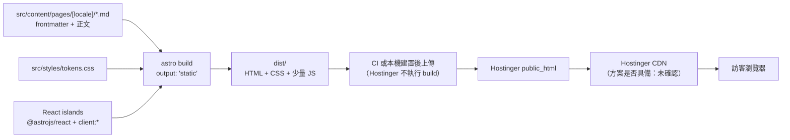

# ADR-001：改用 Astro + React islands，託管移至 Hostinger

| 項目 | 內容 |
|---|---|
| Status | Accepted |
| 日期 | 2026-09-07 |
| 決策者 | 業主（Dale） |
| 相關 PRD | [PRD-001](../prd/PRD-001-architecture-refactor.md) §8、[PRD-004](../prd/PRD-004-uiux.md) §8、[PRD-005](../prd/PRD-005-brand-guide.md) §8 |

## Status

Accepted（2026-09-07 業主裁定）。部署路徑採 **A**（ADO Pipeline 建置後以 SFTP 推送 `dist/`）；staging 使用帳號內的暫時網域 `*.hostingersite.com`（該站現為空白 WordPress，部署時覆蓋），驗證通過後才切 `synaiq.com`。業主同日裁定**視覺全面重做**：本 ADR 不移植任何舊視覺，元件重建待 PRD-005／PRD-003 設計方向定案。
本案同時觸發 [`README.md`](README.md) 的「框架變更」與「託管或部署變更」兩條開立條件。

## Context

舊站建立在 `vinext@1.0.0-beta.2`（Vite 生態的 Next App Router 相容層），跑在 Cloudflare Worker、託管 OpenAI Sites，
技術現況見 [`../../HANDOVER.md`](../../HANDOVER.md) §1。四項事實使「原地清理」不成立：

| # | 事實 | 後果 |
|---|---|---|
| 1 | 框架是單一 beta 相容層，非 Next.js 本體 | 升級路徑、求助管道、可招募人力皆近乎零；beta 行為變動無回歸網 |
| 2 | repo 內零部署設定（HANDOVER §7-1），公司實際持有的是 Hostinger 帳號 | Cloudflare Worker 產物放不進 Hostinger `public_html`，託管前提已改變 |
| 3 | 內容靠自寫 `## key` 解析器加 Vite `?raw` 內嵌 | 無 schema、無型別、無 per-locale 結構；雙語（PRD-004）疊在其上更貴 |
| 4 | Tailwind v4 已安裝但全站零 utility class | 純依賴負擔 |

9 條純內容路由並不需要 RSC 與 Worker 執行環境。

## Decision

**換底重建為 Astro 靜態輸出加 React islands，產物以靜態檔案託管於 Hostinger `public_html`。**

| 面向 | 決策 |
|---|---|
| 框架 | Astro 7.x（最新穩定 7.3.1，需 Node ≥ 22.12.0），`output: 'static'`，產物預設 `dist/` |
| 元件 | 預設 `.astro`（零 client JS）；僅真正互動處以 `@astrojs/react` 建 island，用 `client:*` 指定水合時機 |
| 託管 | Hostinger **Business Web Hosting**（已確認，效期至 2029-02-17），靜態檔置於 `public_html`。同帳號下 `synaiq.com` 目前是 WordPress 站（2025-07-16 建，每日備份），切換即退役該 WP；帳號另有一個暫時網域 `*.hostingersite.com` 可當 staging |
| 樣式 | 純 CSS：`src/styles/tokens.css` 的 CSS custom properties 為單一事實來源；React island 用 CSS Modules、`.astro` 用 scoped `<style>`，兩者共用同一組 token。**移除 Tailwind** |
| 手冊 | 三合一：`src/styles/tokens.css` 加 `/styleguide` 路由（noindex）加 `docs/` 手冊文件。Token **數值與用法**歸 PRD-005，**機制**歸 PRD-001 |
| 內容 | markdown 仍是編輯介面，改為 Astro Content Collections：`src/content/pages/<locale>/<page>.md`，frontmatter 以 zod schema 驗證，正文 markdown 為 body |
| i18n | Astro 內建 i18n 路由，`defaultLocale: 'zh-Hant'`、`routing.prefixDefaultLocale: false`，英文為 `/en/` 前綴。IA 與切換 UX 仍歸 PRD-004 |

**已查證的部署限制**：Hostinger 的 Git 部署**不執行 build**，只把 repo 內既有檔案原樣送到 `public_html`；
原生自動部署綁 GitHub OAuth，其他 Git host 需走 SSH 部署加手動 push webhook。本案 repo 在 Azure DevOps，
因此 build 必須發生在 Hostinger 之外（CI 或本機），上傳的是已建好的 `dist/`。

**hPanel 實際觀察（2026-09-07）**：Business 方案另有「Web Apps」託管，可連 GitHub 自動部署或上傳 ZIP，
官方列出支援 Next.js、Vite、React 等框架，Astro 靜態輸出適用。因此可行的部署路徑有三條，由 PRD-001 FR-109 擇一定案：

| 路徑 | 做法 | 取捨 |
|---|---|---|
| A | ADO Pipeline 建置後以 SFTP/FTP 推送 `dist/` 至 `public_html` | 全在 ADO 內，需保管 FTP 憑證於 pipeline secret |
| B | ADO 鏡像到 GitHub，Hostinger Web Apps 自動建置部署 | 部署最省事，但多一個 GitHub 鏡像要維護 |
| C | 本機建置後於 hPanel 上傳 ZIP 或 File Manager | 零設定，但人工步驟，不可長期 |

### 被否決的方案

| 方案 | 否決理由 |
|---|---|
| Next.js 15 靜態匯出（`output: 'export'`） | 為 9 條內容頁扛整套 React runtime 與 App Router 心智負擔；零 JS 要自行剋制而非預設 |
| Vite + React SPA | 行銷站做成 SPA 使 SEO 與 LCP 倒退，且路由、metadata、sitemap 全需自建 |
| 保留 `vinext` 只做清理（PRD-001 v0.2 原方案） | 不解決事實 1 與 2；Worker 產物與 Hostinger 靜態託管不相容 |

## Consequences

| 面向 | 影響 |
|---|---|
| 正面 | 內容頁預設零 client JS，效能門檻由架構保證而非事後最佳化；`## key` 解析器換成 zod schema，內容錯誤仍在 build 期失敗且能指出檔名與欄位；雙語為框架內建；靜態檔可搬到任何主機，鎖定風險最低；Astro 是主流框架，招募與求助管道正常 |
| 負面 | 全數重寫、舊樹零沿用；團隊需學 Astro 與 island 邊界；首頁 GSAP 捲動敘事需以 island 重做（成本待估）；Hostinger 不 build，須自建 CI 或人工上傳；`synaiq.com` 現行 WordPress 站需規劃退役與切換窗口；方案是否含 CDN 未確認 |
| 變難 | 部署不再是「push 就上線」，多一段 build 產物搬運；island 邊界判斷錯誤會把整頁 JS 拉回來 |
| 變易 | 改文案只動 frontmatter 欄位、錯欄位當場建置失敗；新增語系只加目錄不改元件；換 token 一處生效並可在 `/styleguide` 直接驗收 |
| 編輯流程 | 由「改 `## key` 區塊」變為「改 frontmatter 欄位加正文」；仍需重新 build 才生效 |
| 後續動作 | PRD-001 改寫為 v0.3；PRD-004 §8、PRD-005 §8 各加一列；[`README.md`](README.md) 索引加列；Sprint 22 的 #1304／#1305／#1306 擬關閉，#1303／#1307 擬改題 |

## 附錄：查證來源

| 主題 | 文件 |
|---|---|
| Astro 最新穩定版與 Node 需求（7.3.1、`engines.node >= 22.12.0`） | https://registry.npmjs.org/astro/latest |
| React 整合安裝與用途 | https://docs.astro.build/en/guides/integrations-guide/react/ |
| `client:load`／`idle`／`visible`／`media`／`only` 水合指令 | https://docs.astro.build/en/reference/directives-reference/ |
| i18n 路由（`locales`、`defaultLocale`、`routing.prefixDefaultLocale`） | https://docs.astro.build/en/guides/internationalization/ |
| Content Collections、`glob()` loader 與 zod schema | https://docs.astro.build/en/guides/content-collections/ |
| `output: 'static'`、`outDir` 預設 `./dist` | https://docs.astro.build/en/reference/configuration-reference/ |
| Hostinger Git 部署（不執行 build、GitHub OAuth 或 SSH、預設 `public_html`） | https://docs.hostinger.com/websites/git |
| Hostinger 方案型別、`synaiq.com` 為 WordPress、Web Apps 功能（GitHub 或 ZIP） | hPanel 實際觀察，2026-09-07 |
