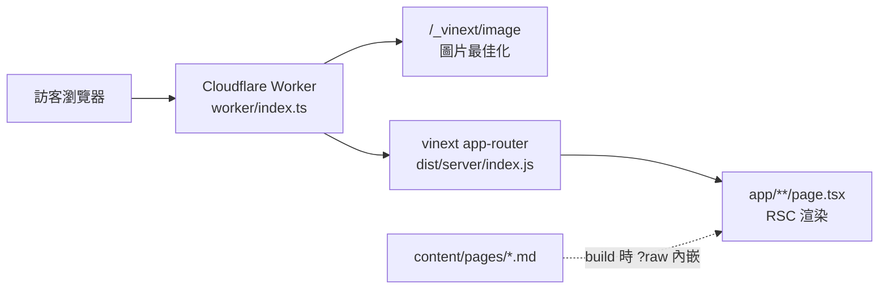

# PRD Guideline（網站專案精簡版）

| 版本 | 狀態 | Owner | ADO Feature | 最後更新 |
|---|---|---|---|---|
| v0.1 | Draft | Dale | [#1301](https://dev.azure.com/synaiq/SynaiqDev/_workitems/edit/1301) | 2026-09-07 |

## 0. 本文件定位

本文件是公司全域 guideline `C:\Users\User\.claude\guidelines\PRD-Architecture-Guideline.md`
的**網站專案 profile**：只保留單一行銷網站用得到的部分，並補上前端特有的量化門檻。
**兩者衝突時一律以全域版為準**，本文件僅能收斂範圍，不得放寬全域的安全與變更管理要求。
被裁掉的章節與理由見 §7。

## 1. 啟動四問（寫 PRD 前必答，任一答不出來就停下來問業主）

| 問 | 要求 |
|---|---|
| Problem | 一段話講現況痛點，禁止跳過，禁止用「為了更好」這種空話 |
| Goal | ≤ 3 條且可量化（例：Lighthouse A11y 由 78 提升至 ≥ 95） |
| Non-Goal | ≤ 3 條，明寫本次不做什麼，用來擋範疇蔓延 |
| Constraints | 技術、資產、時程、外部阻塞（例：文案卡行銷部簡報） |

角色（Persona）併入 §1，≤ 3 個，各一行。本站訪客角色單純，不另開章節。

## 2. PRD 標準章節

固定 8 節，**不得增減**，順序見 [`../prd/_TEMPLATE.md`](../prd/_TEMPLATE.md)：
問題與目標／範圍／功能需求／NFR 差異／風險／驗收方式／Open Questions／變更紀錄。
每份 PRD ≤ 2 頁（約 110 行），5 分鐘內可讀完。表格優先於敘述。

## 3. 編號與追溯

- `FR-XXX` 全案唯一，前綴即 PRD 號：`FR-1xx` 屬 PRD-001、`FR-2xx` 屬 PRD-002，依此類推。
- 每個 FR 對應一個 ADO Task，填在 FR 表的「ADO Task」欄；Task 於該 FR 開工前才開立。
- PRD 標頭掛 ADO Feature，Epic 只在 [`../README.md`](../README.md) 出現一次。
- 驗收條件必須可被指令、量測或明確的人工檢查步驟證明，不接受「看起來正常」。

## 4. NFR 基準線（全站繼承，PRD 只寫差異）

| 維度 | 目標值 |
|---|---|
| Lighthouse（行動裝置） | Performance ≥ 90、Accessibility ≥ 95、Best Practices ≥ 95、SEO ≥ 95 |
| Core Web Vitals | LCP ≤ 2.5s、INP ≤ 200ms、CLS ≤ 0.1 |
| 無障礙 | WCAG 2.2 AA |
| 外部依賴 | 零 mixed content、零 `localhost` 外部依賴 |
| 資產體積 | 字型 subset 後 ≤ 300 KB（WOFF2）、單張圖 ≤ 500 KB、`public/` 總量 ≤ 15 MB |
| 安全標頭 | HTTPS + HSTS + `X-Content-Type-Options` + `Referrer-Policy` + CSP |
| 語系標記 | `<html lang>` 依 locale 正確；雙語頁面 `hreflang` 成對（含 `x-default`） |
| SEO | 每頁唯一 title/description、canonical 正確、`sitemap.xml` 涵蓋所有 locale |
| 建置 | `npm run build` 與 `npm test` 綠燈 |
| 密鑰 | 無硬編碼密鑰；疑似外洩者列輪替待辦 |

## 5. 風險登錄表

固定 4 欄，每份 PRD **至少 3 列**：

| 風險 | 機率 (L/M/H) | 衝擊 (L/M/H) | 緩解 |
|---|---|---|---|

## 6. 變更管理

- 版本：`v0.x` 草稿 → `v1.0` Locked。狀態機：Draft → Review → Locked → Done。
- **Locked 前**的修改：在 §8 變更紀錄加一列，版本 +0.1，不需 ADR。
- **Locked 後**的範圍或架構變更：必須開 `docs/adr/ADR-NNN`，並在 PRD §8 與 ADR 中雙向連結。
- 每次文件更新即一個 commit，commit message 帶 PRD 號（例：`docs: PRD-004 補 i18n URL 決策`）。

## 7. 全域 guideline 不適用章節對照

| 全域章節 | 決策 | 理由 |
|---|---|---|
| 1 Overview & Context | 併入 §1 問題與目標 | 單一行銷站，無上下游系統 |
| 3 User Stories & Personas | 降為 §1 內一列，≤ 3 角色 | 訪客角色單純 |
| 6 System Architecture（C4 三圖） | 降級為本文件 §9 一張共用圖 | 單一 Worker，無多容器 |
| 7 Data Model | 不適用 | 無 DB；`hosting.json` 的 d1/r2 皆 null，`drizzle/` 零 migration |
| 8 API Contract | 不適用 | 無對外 API；唯一端點 `/_vinext/image` 為框架內建 |
| 10 Observability | 精簡為 NFR 一列 | 無自建監控，靠 Cloudflare 內建加 Lighthouse 抽查 |
| 12 Rollout & Migration | 精簡為一句：`git revert` 加重新 build | 靜態站，無資料遷移 |
| 13 覆蓋率 ≥ 80% | 改為渲染測試加 build 綠燈加 Lighthouse 門檻 | 幾無業務邏輯層 |
| 4.4 IEC 62443 / OT-IT | 不適用 | 非工控產品 |
| 11 EMS 特化 | 不適用 | 同上 |
| 11.2 doc-sync 三件套 | 置換為本案三件套：[`docs/README.md`](../README.md)、視覺手冊（PRD-005 產出）、[`HANDOVER.md`](../../HANDOVER.md) | 本案無 API.yaml／容器速查表／操作手冊 |

## 8. 提交前 Checklist

- [ ] §1 四問齊全，Goal 可量化
- [ ] 每個 FR 有編號、驗收條件、ADO Task 欄位
- [ ] §4 只寫與基準線的差異，無差異寫「無」
- [ ] 風險 ≥ 3 列，四欄齊全
- [ ] §6 驗收方式寫得出指令或量測步驟
- [ ] Open Questions 有待決者與期限
- [ ] 全文 ≤ 110 行，未複製其他文件已寫過的內容

## 9. 全案共用架構圖

PRD 只引用本圖，不得自行重畫。技術細節見 [`HANDOVER.md`](../../HANDOVER.md) §1。

